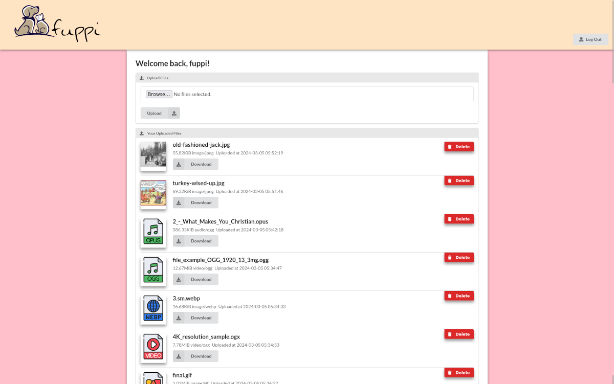

# 🚀 Phuppi 2.0

A PHP file-uppie thingy. Share your files and notes easily. Keep your data safe with top-notch security. 

– new feature: **mind-blowing P2P file sharing**!! transfer files directly between devices - no need to install apps! On the same network it is a direct connection; over the internet it falls back to an end-to-end encrypted PHP relay, so it works on plain FTP hosting too (needs HTTPS).



## ⚡ Quick Start – Up and Running in 2 Minutes

1️⃣ Grab the code: [from Github](https://github.com/AntzCode/phuppi/archive/refs/heads/main.zip)  
2️⃣ Unzip and upload to your server: [cPanel - how to upload files with FTP](https://docs.cpanel.net/knowledge-base/ftp/how-to-upload-files-with-ftp/)  
3️⃣ Open your website in your browser and set a username/password for the admin account  [(↗️ screenshot)](./assets/screenshots/installation.png)  

No tricky database configuration needed - it uses [SQLite](https://sqlite.org/)!

## 🎯 Share in Seconds

1. Login.
2. Upload files or write notes.
3. Generate a unique link to the download (choose an expiry if you want).
4. Share the link!

## 🔥 Why Phuppi Rocks

- **Seamless integration with S3** - makes connecting to cloud storage easy.
- **Zero-setup magic** – Database is automatically created using SQLite.
- **Fort Knox security** – bcrypt passwords, one-time vouchers, expiring tokens.
- **Dead simple** – Upload, share, done. No tutorials needed.
- **All-in-one party** – Files, notes, auth, storage – bundled!

## 📋 Features That Wow

- Multiple File Uploader  [(↗️ screenshot)](./assets/screenshots/multiple-file-uploader.png)
- User Management and Flexible Permissions [(↗️ screenshot)](./assets/screenshots/users.png)
- Instant-access vouchers to easily share your upload rights with friends [(↗️ screenshot)](./assets/screenshots/vouchers.png)
- Flexible storage connectors - local filesystem or S3 [(↗️ screenshot)](./assets/screenshots/storage-connectors.png)
- Data migration tool for migrating data between S3 buckets [(↗️ screenshot)](./assets/screenshots/storage-connector-migration.png)
- De-duplicator tool for cleanup [(↗️ screenshot)](./assets/screenshots/duplicates.png)
- Token-based sharing for files & notes [(↗️ screenshot)](./assets/screenshots/share-link.png) [(↗️ screenshot)](./assets/screenshots/shared-note.png)
- Batch file sharing - share multiple files with a single link [(↗️ screenshot)](./assets/screenshots/batch-share.png)
- URL Shortener - create short, memorable links with configurable expiration [(↗️ screenshot)](./assets/screenshots/url-shortener.png)
- Local filesystem storage or S3-compatible API support [(↗️ screenshot)](./assets/screenshots/active-storage-connector.png)
- Docker-ready configuration for dev & prod
- Automatic preview thumbnails for files (images, videos, documents) with configurable background queue processing (CLI worker or AJAX for shared hosting) [(↗️ screenshot)](./assets/screenshots/preview.png)
- P2P File Sharing – Share via QR code or URL, files flow straight from sender to receiver (or through an encrypted relay on your own server when a direct connection is impossible)!

## ☁️ Supported Cloud Storage Providers

Phuppi supports multiple storage backends, making it easy to keep your data in the cloud:

- **Local Filesystem** - Default storage on your server
- **Amazon S3** - AWS Simple Storage Service
- **Digital Ocean Spaces** - S3-compatible object storage
- **Garage / MinIO** - Self-hosted S3-compatible storage (Garage is used for local development)
- **Any S3-Compatible Provider** - Works with any service implementing the S3 API

All cloud storage options support the migration tool for moving data between connectors, including the new transfer limit feature for managing bandwidth usage.

## 🏗️ Under the Hood

Phuppi is made to be easy for owners to upload and modify. It has a lean file structure and avoids bloated libraries and complicated build tools. You can make changes to the code using the most modern libraries and techniques, and your changes are reflected as soon as you refresh the page!

- **Framework:** [Flight micro-framework for PHP](https://docs.flightphp.com/en/v3/)
- **Database:** [SQLite](https://sqlite.org/) (configuration not required)
- **Storage:** Local files or [S3-Compatible](https://aws.amazon.com/s3/) Cloud Storage
- **Security:** bcrypt, sessions, tokens
- **Templating:** [Latte templates for PHP](https://latte.nette.org/en/)
- **Frontend:** [Preact standalone edition](https://preactjs.com/)

## ⚡ Run on Docker for local development (takes just 5 Minutes)

```bash
# 1️⃣ Grab the code
git clone https://github.com/AntzCode/phuppi.git
cd phuppi

# 2️⃣ customise the settings
cp .env.example .env
nano .env # or right-click and open with your IDE

# 3️⃣  Fire up Docker (localhost only; --bind=IP publishes on one address, --lan on every address)
./dev up

# 4️⃣ Set it up
docker exec -it phuppi php src/bootstrap.php install

# 5️⃣ Boom! Open http://localhost
```

**Pro tip:** add garage to your hosts file if you want to use the local Garage S3 container 🔐

`echo "127.0.0.1 garage" | sudo tee -a /etc/hosts`

**HTTPS for development** (needed to install Phuppi as an app and share to it from a phone). The stack includes a Caddy proxy that serves the app and the Garage bucket over HTTPS from one address, with certificates from its own local CA:

```bash
# Optional: the names or IPs devices on your network use to reach this machine
printf "DEV_HOSTS=localhost, 192.168.1.20\nDEV_DEFAULT_HOST=192.168.1.20\n" >> .env
./dev up --lan   # --lan publishes the ports on every address; plain ./dev up is localhost only
```

Open `https://localhost`, or `https://192.168.1.20` from a phone on the same network. Browsers will warn until they trust the local CA: download it from `https://<host>/dev-ca.crt` (or `docker compose cp caddy:/data/caddy/pki/authorities/local/root.crt .`) and install it as a CA certificate (Android: Settings → Security → Install a certificate → CA certificate). Chrome will not register the service worker or offer to install the app on an untrusted certificate. Uploads to Garage go through the same HTTPS address, so the `garage` hosts entry is not needed there. The LAN address is good for the web UI and uploads, but Chrome only installs a real app (needed for the Android share sheet) on a public HTTPS domain, so test sharing there. Plain `http://localhost` works too, with S3 uploads, because the same Caddy proxy answers on port 80.

**Running next to other projects with [LanProjectsControlPanel](https://github.com/AntzCode/LanProjectsControlPanel) (lpcp):** register it once from the lpcp repo, then start it from the panel or with `./dev up` here:

```bash
./dev add phuppi /path/to/phuppi --up './dev up --bind={bind} --host={host}'   # https://phuppi.localhost
```

`./dev up --bind=IP` publishes the ports on one address, `--host=NAME` serves that name, and `--lan` publishes on every address. Names other than `*.localhost` need a hosts-file entry pointing at the address.

## 📚 Documentation

To generate API documentation using phpDocumentor:

```bash
docker compose run --rm phpdoc phpdoc -d src -t docs
```

The generated documentation will be available in the `docs/` directory. Open `docs/index.html` in your browser to view it.

## 🤝 Contribute

Love it? Fork, tweak, PR! Check [`CONTRIBUTING.md`](CONTRIBUTING.md).

## 📄 License

GPLv3 – See [`LICENSE`](LICENSE). 

You are free to use, study, and modify this software. If you distribute the program or a derivative, you must provide the full source code and license the entire work under GPL‑v3 (or a later version), ensuring the same rights for downstream users.

---

*Ready to share securely? Let's go!* 🚀
