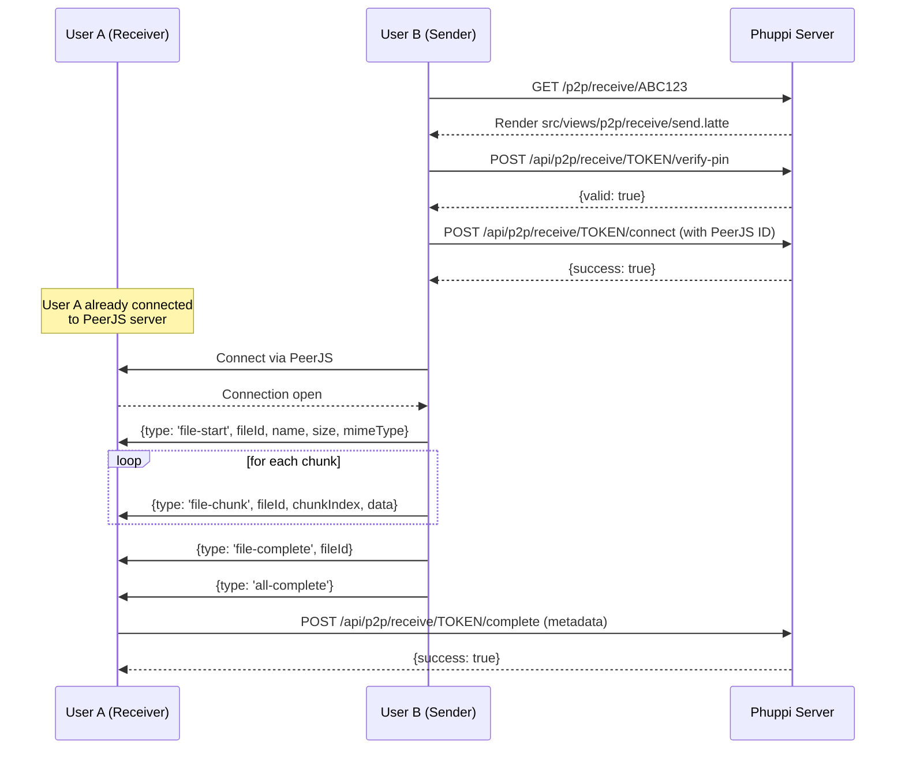

# Reverse P2P File Receiving - Implementation Plan

**Author:** Anthony Gallon  
**Contact:** https://github.com/AntzCode  
**Created:** 2026-04-12  
**Status:** Implemented

## 1. Executive Summary

This plan outlines the implementation of a "Reverse P2P" file receiving feature where:
- **User A** (logged-in) creates an empty receive session and shares a URL/QR code
- **User B** (guest, no login) opens the page, enters PIN, selects files, and sends them via WebRTC P2P

The existing P2P implementation is sender-directed (User A selects files → User B downloads). Reverse P2P flips this flow.


---

## 2. Database Schema

### 2.1 Migration Status

**Current:** Migration 014 exists.

**Required:** Create migration `015_add_p2p_receive_sessions_table.php`

### 2.2 Table Design

```sql
CREATE TABLE p2p_receive_sessions (
    id INTEGER PRIMARY KEY AUTOINCREMENT,
    user_id INTEGER NOT NULL,
    token VARCHAR(64) NOT NULL UNIQUE,
    shortcode VARCHAR(12) NOT NULL UNIQUE,
    peerjs_id VARCHAR(64) NULL,
    pin VARCHAR(2) NOT NULL,
    pin_attempts TINYINT DEFAULT 0,
    pin_locked_at DATETIME NULL,
    files_metadata TEXT NULL,
    created_at DATETIME NOT NULL,
    expires_at DATETIME NOT NULL,
    is_active BOOLEAN NOT NULL DEFAULT 1,
    FOREIGN KEY (user_id) REFERENCES users(id)
);
```

### 2.3 Schema Notes

| Field | Description |
|-------|-------------|
| `token` | 64-char cryptographically secure token for API access |
| `shortcode` | 12-char alphanumeric for human-readable URLs |
| `peerjs_id` | Registered PeerJS ID for incoming connections |
| `pin` | 2-digit PIN (10-99) for MITM protection |
| `files_metadata` | JSON array storing received file metadata |
| `expires_at` | Session expiration (default: 24 hours, configurable) |

---

## 3. Model Class Design

### 3.1 P2PReceiveSession.php

Create new model at `src/Phuppi/P2PReceiveSession.php` following the pattern in `P2PShareToken.php`:

```php
class P2PReceiveSession
{
    // Properties matching table columns
    public $id;
    public $user_id;
    public $token;
    public $shortcode;
    public $peerjs_id;
    public $pin;
    public $pin_attempts;
    public $pin_locked_at;
    public $files_metadata;
    public $created_at;
    public $expires_at;
    public $is_active;

    // Methods
    public static function create(int $user_id): self;
    public static function findByToken(string $token): ?self;
    public static function findByShortcode(string $shortcode): ?self;
    public static function findActiveByUserId(int $userId): array;
    public function save(): bool;
    public function delete(): bool;
    public function isExpired(): bool;
    public function isLocked(): bool;
    public function verifyPin(string $pin): bool;
    public function getFilesMetadata(): array;
    public function addFileMetadata(array $file): void;
    public static function generateToken(): string;
    public static function generateShortcode(): string;
    public static function generatePin(): string;
}
```

---

## 4. Controller Endpoints

### 4.1 Required Routes

Add to `src/routes.php`:

| Method | Endpoint | Auth | Description |
|--------|----------|------|-------------|
| POST | `/api/p2p/receive/create` | Required | Create receive session |
| GET | `/api/p2p/receive` | Required | List user's receive sessions |
| GET | `/api/p2p/receive/@token` | Public | Get session metadata |
| DELETE | `/api/p2p/receive/@token` | Required | Cancel session (owner) |
| GET | `/p2p/receive/@shortcode` | Public | Render guest sender page |
| POST | `/api/p2p/receive/@token/verify-pin` | Public | Verify PIN |
| POST | `/api/p2p/receive/@token/connect` | Public | Register PeerJS ID |
| POST | `/api/p2p/receive/@token/complete` | Public | Save received files metadata |

### 4.2 Controller Methods

Add to `P2PController.php`:

```php
// === Receive Session Management ===

/**
 * Create a new P2P receive session
 * POST /api/p2p/receive/create
 */
public function createReceiveSession(): void;

/**
 * List user's receive sessions
 * GET /api/p2p/receive
 */
public function listReceiveSessions(): void;

/**
 * Get session metadata (public)
 * GET /api/p2p/receive/@token
 */
public function showReceiveSession(string $token): void;

/**
 * Cancel receive session (owner only)
 * DELETE /api/p2p/receive/@token
 */
public function deleteReceiveSession(string $token): void;

/**
 * Render guest sender page
 * GET /p2p/receive/@shortcode
 */
public function showReceivePage(string $shortcode): void;

/**
 * Verify PIN (public)
 * POST /api/p2p/receive/@token/verify-pin
 */
public function verifyReceivePin(string $token): void;

/**
 * Register PeerJS ID for receive session
 * POST /api/p2p/receive/@token/connect
 */
public function connectReceiveSession(string $token): void;

/**
 * Save received files metadata
 * POST /api/p2p/receive/@token/complete
 */
public function completeReceiveSession(string $token): void;
```

---

## 5. Frontend UI Flow

### 5.1 User A Flow (Logged-in Receiver)

```
+------------------------+
|  User clicks "Receive   |
|  Files" button          |
+----------+-------------+
           |
           v
+------------------------+
|  POST /api/p2p/receive  |
|  /create                |
+----------+-------------+
           |
           v
+------------------------+
|  Show p2p/receive/      |
|  create.latte           |
|  - Display QR code     |
|  - Display share URL   |
|  - Display PIN         |
+----------+-------------+
           |
           v
+------------------------+
|  Redirect to p2p-      |
|  receive-waiting.latte |
|  - Poll for connection |
|  - Show status         |
+----------+-------------+
           |
           v
+------------------------+
|  Files arrive via      |
|  WebRTC P2P            |
+----------+-------------+
           |
           v
+------------------------+
|  Show download UI      |
|  - List received files |
|  - Download buttons   |
+------------------------+
```

### 5.2 User B Flow (Guest Sender)

```
+------------------------+
|  User visits URL or    |
|  scans QR code         |
+----------+-------------+
           |
           v
+------------------------+
|  Render p2p/receive/   |
|  send.latte (guest  |
+----------+-------------+
           |
           v
+------------------------+
|  PIN Entry Screen      |
|  - 2-digit input       |
+----------+-------------+
           |
           v
+------------------------+
|  POST verify-pin API   |
|  - Valid: show send UI |
|  - Invalid: retry      |
+----------+-------------+
           |
           v
+------------------------+
|  File Selection UI     |
|  - Select files        |
+----------+-------------+
           |
           v
+------------------------+
|  Connect via PeerJS   |
|  - Register peer ID    |
+----------+-------------+
           |
           v
+------------------------+
|  Send files via P2P   |
|  - Chunk & transfer    |
+----------+-------------+
           |
           v
+------------------------+
|  Show "Files sent"    |
|  confirmation         |
+------------------------+
```

---

## 6. Views to Create

### 6.1 src/views/p2p/receive/create.latte

- "Receive Files" button on main file list
- Creates session via API
- Shows: QR code, share URL (copy button), PIN display

### 6.2 src/views/p2p/receive/waiting.latte

- Status: "Waiting for sender to connect..."
- Auto-refresh/Poll: Check for incoming P2P connection
- Shows: Session info, cancel button, copy link button

### 6.3 src/views/p2p/receive/send.latte (EXISTS in issue but NOT in codebase)

- **Note:** This file does NOT currently exist and needs to be created
- Reuses logic from `p2p-sender.latte` but in "reverse" mode
- Guest selects files (not predefined)
- Connects to User A's PeerJS peer

---

## 7. WebRTC P2P Protocol for File Transfer

### 7.1 Protocol Flow



### 7.2 Message Types

| Type | Direction | Payload |
|------|-----------|---------|
| `file-start` | Sender→Receiver | fileId, name, size, mimeType, lastModified |
| `file-chunk` | Sender→Receiver | fileId, chunkIndex, data (ArrayBuffer) |
| `file-complete` | Sender→Receiver | fileId |
| `all-complete` | Sender→Receiver | (empty) |

### 7.3 Chunking Strategy

Reuse existing chunking logic from `p2p-chunk-storage.js`:
- **Chunk size:** 16KB (CHUNK_SIZE from storage module)
- **Storage:** IndexedDB for received chunks
- **Reconstruction:** Reassemble chunks into Blob on completion

---

## 8. Security Considerations

### 8.1 PIN Protection

- 2-digit PIN (10-99) - human-shareable
- 3 max attempts before 15-minute lockout
- Same PIN verification logic as existing P2P
- Cookie-based verification (1-hour expiry)

### 8.2 MITM Prevention

The PIN provides protection against man-in-the-middle:
1. User A shows PIN to User B (verbally or displayed)
2. User B enters PIN on their device
3. If PIN matches, P2P connection proceeds

### 8.3 Additional Security Measures

- Token: 64-char cryptographically secure random
- Shortcode: 12-char alphanumeric (collision-resistant)
- Session expiry: Default 24 hours
- Active session flag for soft-delete

---

## 9. File Handling

### 9.1 Chunking

Reuse `p2p-chunk-storage.js` functions:
- `saveChunk(fileId, chunkIndex, data)` - Save chunk to IndexedDB
- `getReceivedChunks(fileId)` - Get set of received chunk indices
- `markFileComplete(fileId)` - Mark file as complete
- `reconstructFile(fileId)` - Reconstruct file from chunks

### 9.2 Storage (Receiver Side)

Files received via P2P are stored in IndexedDB:
- Chunks stored in `chunks` object store
- Metadata in `metadata` object store
- Completion status in `completed` object store

### 9.3 Download

After transfer complete:
- Individual file download via `downloadCompletedFile(fileId)`
- All files as ZIP via `downloadAllAsZip()`

---

## 10. Edge Cases

### 10.1 Connection Drops

- **During transfer:** Use existing resume protocol from p2p-sender
- **Sender disconnects:** Receiver stays on waiting page, polls for reconnection
- **Receiver disconnects:** Sender shows error, can retry

### 10.2 Browser Close

- **Sender closes:** Transfer fails, User A sees "connection lost" status
- **Receiver closes:** Use IndexedDB to persist received chunks
- **Page refresh:** Resume from last received chunk (tracked in IndexedDB)

### 10.3 Timeout

- Session expires after 24 hours (configurable)
- Expired sessions return 410 error
- Clean up expired sessions periodically

### 10.4 Error Handling

| Scenario | Handling |
|----------|-----------|
| PIN locked | Show lockout message with countdown |
| Session expired | Show "Session expired" message |
| Network error | Auto-retry with exponential backoff |
| Large file | Same chunking works, may take longer |
| Storage full | Show error, suggest clearing space |

---

## 11. Testing Strategy

### 11.1 Unit Tests

- Model: CRUD operations, PIN verification, expiry checks
- Controller: Authentication, validation, error responses
- API: End-to-end request/response validation

### 11.2 Integration Tests

- User A creates session → GET session metadata
- User B verifies PIN → Success/failure cases
- P2P connection establishment
- File transfer and completion

### 11.3 Browser Testing

- Chrome, Firefox, Safari, Edge
- Mobile browsers (iOS Safari, Chrome for Android)
- Offline/local network mode
- Cross-device transfer (phone to laptop)

### 11.4 Edge Case Testing

- Multiple failed PIN attempts
- Session expiry during transfer
- Browser refresh during transfer
- Connection loss and resume

---

## 12. Implementation Checklist

### Phase 1: Database & Backend

- [ ] Create migration 015 for p2p_receive_sessions table
- [ ] Create P2PReceiveSession model class
- [ ] Add controller methods for receive session management
- [ ] Add routes for receive endpoints

### Phase 2: Receiver Interface (User A)

- [ ] Add "Receive Files" button to file list UI
- [ ] Create session creation API call
- [ ] Create src/views/p2p/receive/create.latte template
- [ ] Implement QR code generation
- [ ] Display shareable URL with copy button
- [ ] Display PIN on receiver's screen
- [ ] Create src/views/p2p/receive/waiting.latte template
- [ ] Implement file download after transfer

### Phase 3: Sender Interface (User B)

- [ ] Create src/views/p2p/receive/send.latte template
- [ ] Implement PIN entry UI
- [ ] Create file selection interface
- [ ] Implement file list display with sizes
- [ ] Add "Send Files" button

### Phase 4: P2P Transfer Engine

- [ ] Extend p2p-chunk-storage.js for receive mode
- [ ] Implement file chunking for large files
- [ ] Add progress tracking UI
- [ ] Implement transfer verification
- [ ] Save metadata to database after transfer

### Phase 5: Polish & Testing

- [ ] Add transfer progress indicators
- [ ] Handle connection failures gracefully
- [ ] Add expiration cleanup job
- [ ] Cross-browser testing
- [ ] Mobile device testing

---

## 13. Reusable Components

| Component | Source |
|-----------|--------|
| QR code generation | qrcode.js (bundled) |
| WebRTC/P2P engine | PeerJS from CDN |
| Chunk storage | p2p-chunk-storage.js |
| ZIP creation | JSZip (bundled) |
| File download | FileSaver.js (bundled) |
| PIN verification | Reuse from P2PShareToken |
| STUN server config | Same as existing P2P |

---

## 14. Dependencies

| Library | Purpose | Source |
|---------|---------|--------|
| qrcode.js | QR code generation | Bundled |
| peerjs | WebRTC signaling | CDN |
| jszip | ZIP file creation | Bundled |
| filesaver | Save downloaded files | Bundled |
| p2p-chunk-storage.js | IndexedDB chunk management | Bundled |

---

## 15. Files to Create/Modify

### New Files

1. `src/migrations/015_add_p2p_receive_sessions_table.php`
2. `src/Phuppi/P2PReceiveSession.php`
3. `src/views/p2p/receive/create.latte`
4. `src/views/p2p/receive/waiting.latte`
5. `src/views/p2p/receive/send.latte`

### Files to Modify

1. `src/Phuppi/Controllers/P2PController.php` - Add receive session methods
2. `src/routes.php` - Add routes for receive endpoints

---

## 16. Acceptance Criteria

- [ ] User A can create a receive session and see share URL/QR code/PIN
- [ ] User B can access the receive URL and verify PIN
- [ ] User B can select files and send them via P2P
- [ ] User A receives files and can download them
- [ ] Session expires after configured time
- [ ] PIN lockout works correctly
- [ ] Works in offline/local network mode
- [ ] Works on mobile browsers